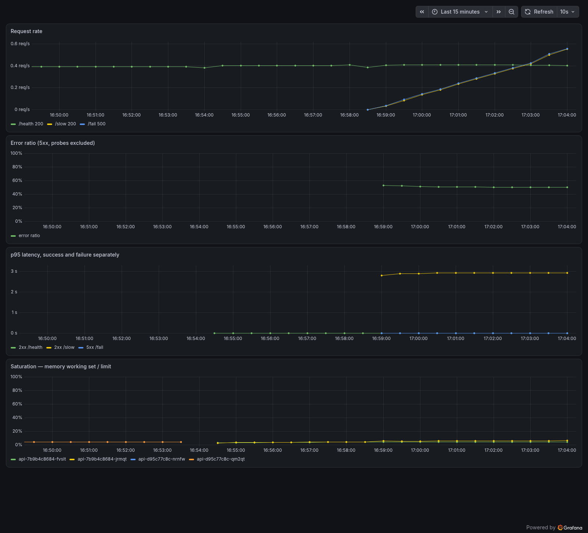
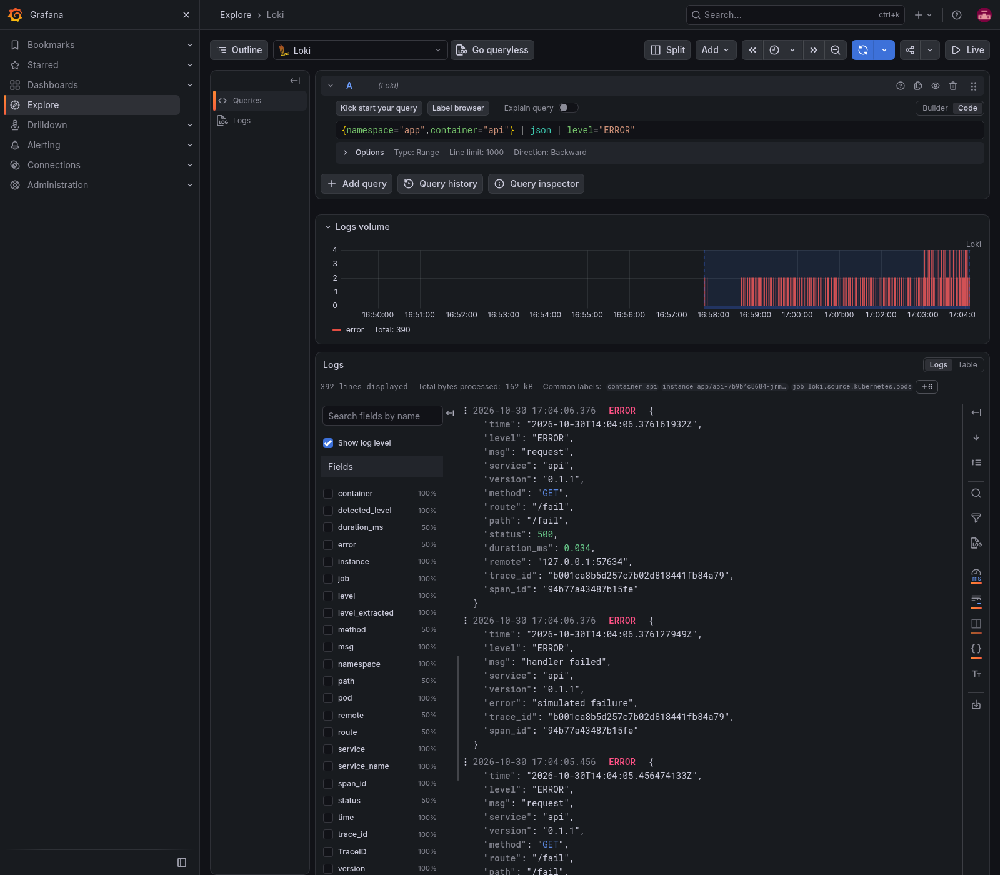
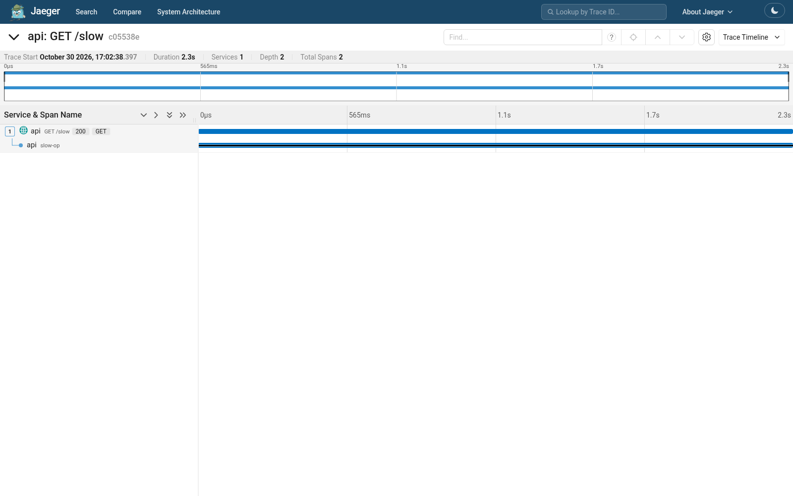
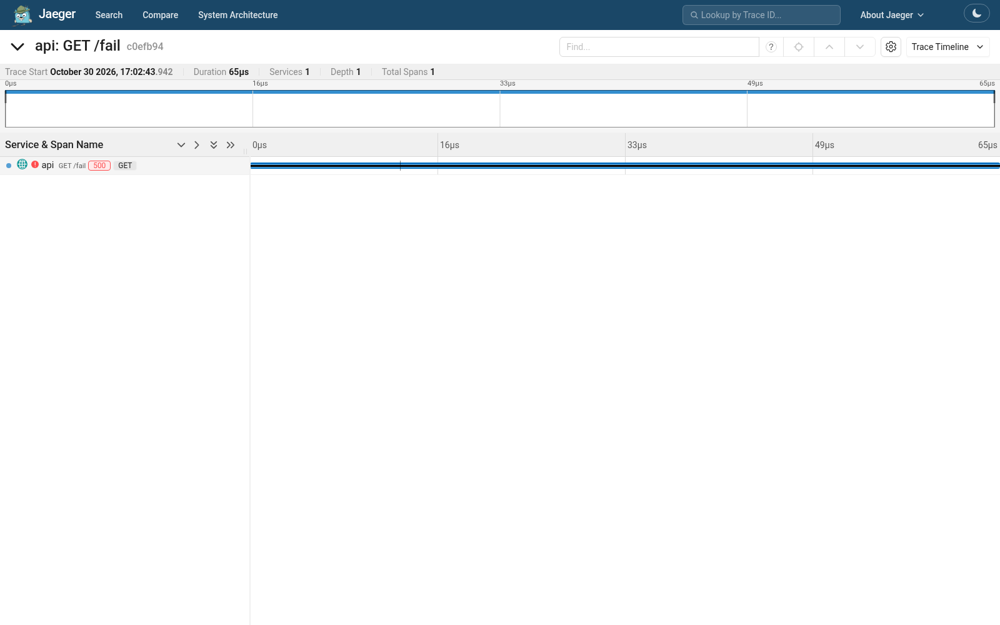
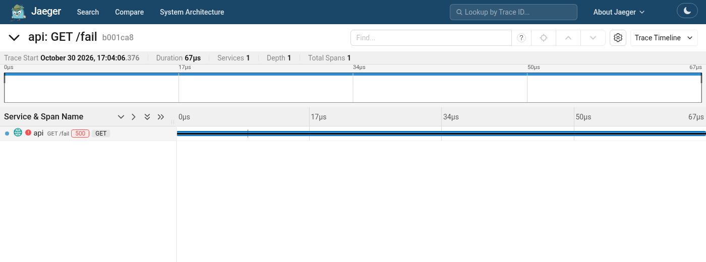
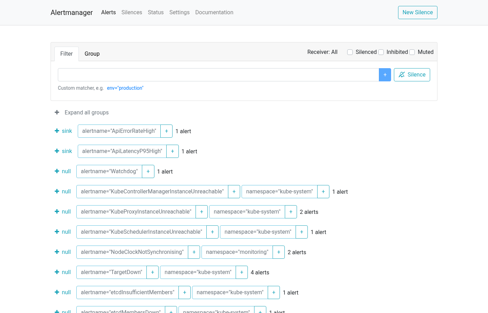
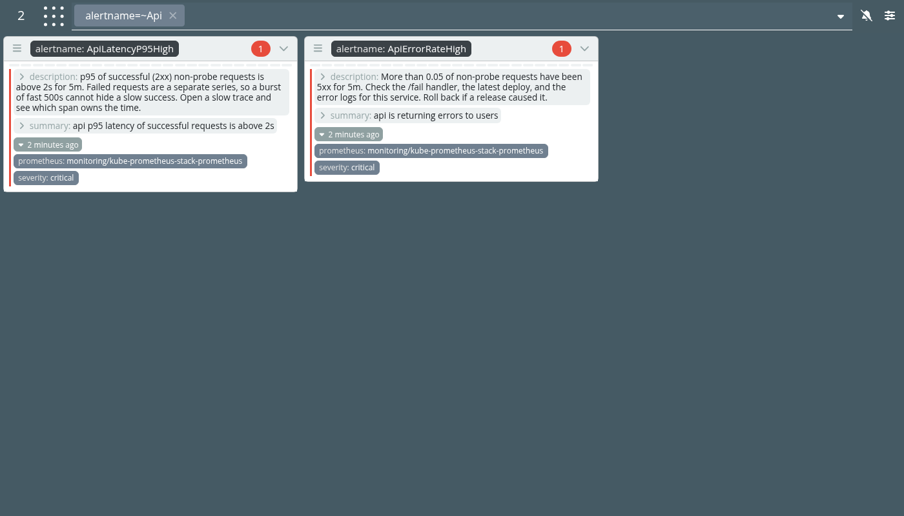
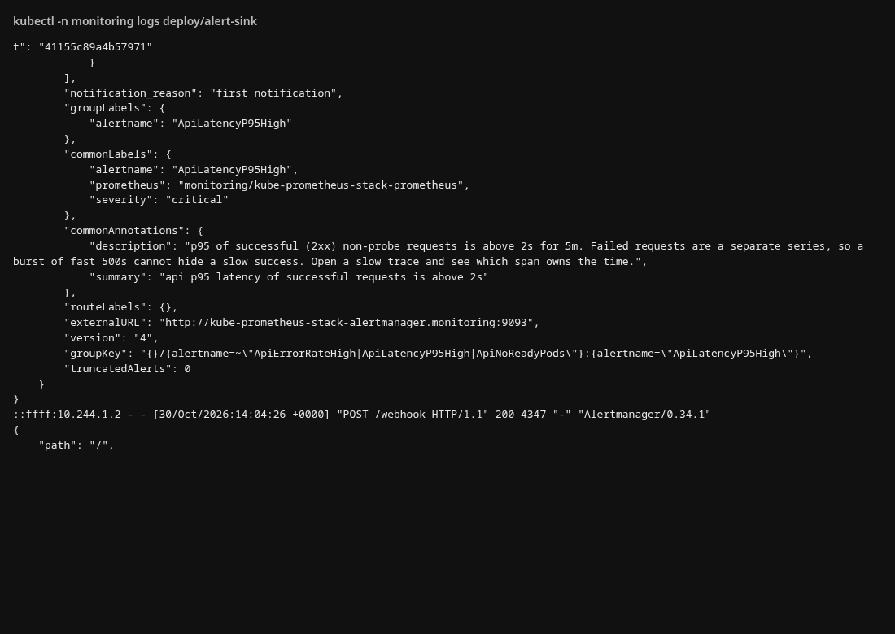
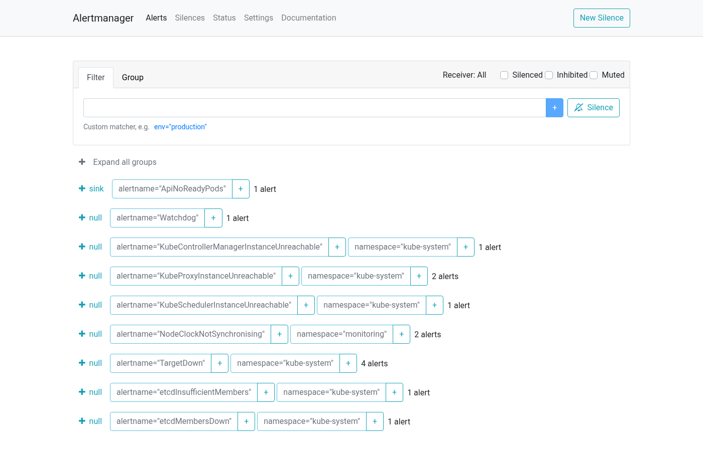

# Лабораторная работа № 2 — метрики, логи, трейсы

Стек наблюдения для одного HTTP-сервиса `api` в локальном кластере kind. Дальнейшие лабораторные переиспользуют этот же стек: `ServiceMonitor` и `PrometheusRule` живут в чарте приложения.

## Информация о работе

- Автор: **Бессонов Владимир Юрьевич, K4111c**
- Операционная система: Arch Linux
- Кластер: kind `lab2`, Kubernetes `v1.37.0`, один control-plane и один worker
- Helm: kube-prometheus-stack `92.14.1`, Loki `7.5.0`, Alloy `1.15.0`, Jaeger `4.16.1`, Karma `2.13.1`

## Цель работы

Собрать один контур наблюдения: Prometheus снимает RED-метрики, Alloy отвозит логи в Loki, Jaeger принимает трейсы по OTLP, Grafana показывает метрики и логи в одном месте, Alertmanager доставляет критические алерты, Karma показывает их списком. Стек ставится Helm'ом и остаётся общим для следующих лабораторных.

## Часть 0 — сервис

Код в [`api`](api). Язык — Go. Общая библиотека [`api/internal/telemetry`](api/internal/telemetry) ставит метрики, JSON-лог и трейсинг; её же сможет импортировать `worker` в следующей лабораторной.

Эндпоинты:

- `GET /health` — `ok`. Запросы kubelet (`User-Agent` начинается с `kube-probe/`) попадают в метрики, но не пишутся в лог и не открывают span: иначе пробы забьют Loki и Jaeger.
- `GET /fail` — HTTP 500, увеличивает `http_errors_total` и ставит span в статус `Error`.
- `GET /slow` — сон 1–3 с внутри дочернего span `slow-op`.
- `GET /load?n=&c=&path=` — пачка запросов на `SELF_URL`. Клиент обёрнут в otelhttp, поэтому у дочерних запросов тот же `trace_id`.

Метрики на `/metrics` (OpenMetrics, чтобы ушёл exemplar):

- `http_requests_total{method,route,code}`
- `http_errors_total{method,route}`
- `http_request_duration_seconds{method,route,code}` — гистограмма отдельно для каждого кода ответа, чтобы быстрые 500 не прятали медленные 200. На наблюдение вешается exemplar `trace_id`
- `app_build_info{version}`

Лог — одна JSON-строка на запрос в stdout: `level`, `route`, `status`, `duration_ms`, `trace_id`, `span_id`. Поле `route` — шаблон маршрута.

Образ — multi-stage в `scratch`, процесс с UID 65532.

## Часть 1 — кластер и registry

Файлы: [`cluster/kind.yaml`](cluster/kind.yaml), [`cluster/registry.sh`](cluster/registry.sh).

Узел kind — контейнер Docker, внутри которого свой containerd. Образ из Docker на хосте containerd узла не видит. Я думал о том, чтобы использовать `kind load docker-image`, но он копирует tarball в containerd уже существующих узлов. Тег `:latest` в Kubernetes по умолчанию имеет `imagePullPolicy: Always`, и kubelet всё равно идёт в Docker Hub за `docker.io/library/<name>:latest`. Локальная копия этот pull не закрывает. Новый worker после `kind load` образа не имеет: между узлами образы не раздаются. Registry даёт одно и то же имя `localhost:5001/api:0.1.0`, которое можно пуллить с `Always`, внести в allow-list политики лабораторной 3 и обновлять новым тегом в лабораторной 6. Образы переживают пересоздание кластера, потому что лежат в контейнере `kind-registry`.

Почему pull `localhost:5001/api:0.1.0` с узла вообще находит registry? Внутри узла `localhost:5001` — сам узел, registry там не слушает. containerd читает `/etc/containerd/certs.d/localhost:5001/hosts.toml` и подменяет хост на `http://kind-registry:5000`, а дальше резолвит имя `kind-registry` через DNS сети Docker `kind` (`172.20.0.1`).

Первый pull у меня упал с `lookup kind-registry ... no such host`. Registry был только на сети `bridge` (`172.17.0.2`). В `registry.sh` проверка `index .NetworkSettings.Networks "kind"` не печатает `null`, если сети нет, и `docker network connect kind kind-registry` не выполнялся. После connect DNS сети `kind` знает имя контейнера, и pull проходит. Ошибка видна на этапе старта пода: apply только пишет spec, образ тянет kubelet.

Проверка: под `t` с образом `localhost:5001/api:0.1.0` дошёл до `Running` и написал JSON-строку `listening`.

## Часть 2 — метрики

Релиз `kube-prometheus-stack` в namespace `monitoring`. Чарт приложения — [`deploy/charts/api`](deploy/charts/api): Deployment на 2 реплики: Service, ServiceMonitor.

По умолчанию оператор выбирает только `ServiceMonitor` со своими Helm-лейблами. `serviceMonitorSelectorNilUsesHelmValues: false` и пустой selector означают «все namespace». То же сделано для `PrometheusRule`, чтобы правила из чарта `api` (и потом `shop`) подхватывались без чужих лейблов. Флаг `exemplar-storage` включён: без него exemplar с `trace_id` на бакете гистограммы выбрасывается.

Оба таргета `job="api"` в namespace `app` отвечали `up = 1`:

- `10.244.1.10:8080/metrics`
- `10.244.1.11:8080/metrics`

Оба пода сели на `lab2-worker`. Control-plane в kind имеет taint `NoSchedule`. Разнос реплик стал подготовкой под 4-ю лабу.

### Как ServiceMonitor становится scrape

Оператор не ходит в под. Он собирает адрес и кладёт его в конфиг Prometheus:

1. `ServiceMonitor` выбирает Service с лейблом `app=api`, порт с именем `http`, путь `/metrics`.
2. Service `api` имеет этот лейбл и порт `http` (8080).
3. Kubernetes держит `EndpointSlice` этого Service: IP готового пода и target port.
4. Prometheus делает GET прямо на `http://<pod ip>:8080/metrics` минуя ClusterIP.

### Откуда берутся чужие метрики в том же Prometheus

Поступил такой вопрос от нейронки и вот такой ответ я осмыслил:

- CPU и память контейнера — cAdvisor внутри kubelet. Он читает cgroup контейнера: `container_cpu_usage_seconds_total`, `container_memory_working_set_bytes`.
- CPU и диск узла — node-exporter, по поду на узел: `node_cpu_seconds_total`, `node_filesystem_avail_bytes`.
- «Deployment хочет 2 реплики, готова 1» — kube-state-metrics. Он смотрит API: `kube_deployment_spec_replicas` — это `.spec.replicas`, `kube_deployment_status_replicas_ready` — сколько подов kubelet пометил Ready. Readiness-проба выставляет condition. В метрику это превращает уже kube-state-metrics.

## Часть 3 — RED

Дашборд лежит в ConfigMap чарта `api` ([`templates/dashboard.yaml`](deploy/charts/api/templates/dashboard.yaml)). Сайдкар Grafana ищет лейбл `grafana_dashboard=1` во всех namespace. По лабе требуется RED, но я, пожалуй, добавлю еще и saturation. На дашборде все четыре, окно `rate` — 5 минут:

- traffic: `sum by (route, code) (rate(http_requests_total[5m]))`. Сырой counter только растёт с рестарта процесса. `rate` переводит его в запросы в секунду, `code` режет 200 и 500 отдельно.
- errors: доля `code=~"5.."` среди запросов с `route!="/health"`. Пробы kubelet почти всегда 200 и затирают долю ошибок пользователя.
- latency: два ряда p95, `code=~"2.."` и `code=~"5.."`. Квантиль считается по корзинам `le`. Складывать уже посчитанный `histogram_quantile` по разным сериям нельзя: сначала суммируются корзины, потом берётся квантиль. Границы корзин заданы в коде (`0.005 … 10` с, плотнее вокруг 1–3 с, где спит `/slow`). p95 интерполируется между границами.
- saturation: working set контейнера делится на `memory` limit из kube-state-metrics.

`/load`, `/fail` и `/slow` двигают все три графика.

## Часть 4 — логи

Loki хранит логи. На каждом узле DaemonSet Alloy читает файлы, которые containerd уже сложил в `/var/log/pods`, и пушит их в Loki. Лог живёт на диске узла, `kubectl logs` читает тот же файл и пропадает вместе с подом. Файл на узле переживает рестарт контейнера, пока его не ротируют.

Релиз `alloy` фильтрует поды по `spec.nodeName`, чтобы каждый агент читал только свой узел. JSON-строки `api` разбираются стадией `stage.json`. `level` становится лейблом Loki. `trace_id` остаётся полем строки. Иначе каждый запрос создавал бы новый поток, и индекс Loki раздулся бы.

Отдельный Deployment `alloy-events` пишет Kubernetes Events в тот же Loki. В иной ситуации два узла прислали бы каждое событие дважды. Events в API живут около часа; в Loki они остаются.

Ошибка `GET /fail` находится в Grafana Explore по `{namespace="app", container="api"} | json | level="ERROR"`. В строке на снимке `trace_id` равен `b001ca8b5d257c7b02d818441fb84a79`. Тот же идентификатор открывает трассу в Jaeger.

## Часть 5 — трейсы

Jaeger v2 (`jaegertracing/jaeger`) поднят all-in-one с memory backend. Adaptive sampling из дефолтного конфига образа выключен, потому что тут нам нужна отдельная трасса. OTLP слушает 4317 (gRPC) и 4318 (HTTP). В чарте `api` задано `OTEL_EXPORTER_OTLP_ENDPOINT=http://jaeger.monitoring.svc.cluster.local:4318`.

otelhttp сам открывает серверный span на входящий запрос и клиентский span на исходящий. `slow-op` — ручной дочерний span вокруг `time.After`, его нет у автоматической инструментации. `/fail` помечает серверный span `codes.Error`, Jaeger рисует его красным.

`/load` ходит на Service тем же клиентом. В исходящий запрос кладётся заголовок `traceparent` , а принимающая реплика продолжает тот же trace - поэтому пачка дочерних запросов видна под одним `trace_id`.

Сэмплирование здесь head-based и включено всегда (`always_on`): решение принимается в процессе до экспорта. Tail sampling решает после того, как трасса собрана, и нужен коллектор, который видит все span одного trace. Для одного сервиса на лабораторной это непозволительная роскошь и `jaeger`, который будет жрать память.

В Grafana у Loki datasource поле `trace_id` — derived field на datasource `jaeger`. У Prometheus включён переход с exemplar `trace_id` на тот же Jaeger.

## Часть 6 — алерты

Правила — `PrometheusRule` в чарте `api`. Также их будет везти чарт `shop`. `for: 5m`: условие должно продержаться пять минут, одиночный выброс остаётся pending и страницей не становится. Prometheus оценивает PromQL и шлёт firing в Alertmanager. Alertmanager группирует по `alertname` и `namespace` (`group_wait: 30s`, `group_interval: 5m`, `repeat_interval: 12h`), чтобы один инцидент не сыпал пачкой сообщений. Receiver по умолчанию — `null`. На webhook `alert-sink` уходят только три алерта `api`. Встроенные правила kube-prometheus (CPU, диск, kubelet, Watchdog) в Prometheus остаются и годятся для разбора, но дежурного не будят. Karma читает Alertmanager и показывает активные алерты отдельно от тонкого UI Alertmanager.

Три правила, и все оптимизированы под боль пользователя:

1. **ApiErrorRateHigh** — доля 5xx среди запросов не на `/health` выше 5% пять минут подряд. Ловит сломанный релиз или зависимость, от которой клиент уже получает ошибку. Дежурный смотрит лог с тем же `trace_id` и откатывает релиз или чинит зависимость. Пробы исключены: они почти всегда 200 и разбавляют долю.
2. **ApiLatencyP95High** — p95 успешных (2xx) запросов не на `/health` выше 2 с пять минут подряд. Порог 2 с — это прям буквально из лекции взято. Считается только успешная серия: пачка быстрых 500 не занижает p95 медленных 200. Дежурный открывает медленную трассу и смотрит, какой span съел время (`slow-op` в этом опыте).
3. **ApiNoReadyPods** — ни одного Ready пода `api` пять минут. Service ещё может обслуживать вторую реплику, и будить человека из-за одного пода не за чем. Ноль готовых подов значит, что запросу некуда приехать. Дежурный смотрит Events (image pull, readiness, scale 0).

Срабатывание: `/fail` и `/slow` держались дольше `for`. Alertmanager отдал `ApiErrorRateHigh` и `ApiLatencyP95High` на receiver `sink`, а встроенные правила (Watchdog, kubelet, etcd) остались на `null`. Webhook с телом алерта записан в лог `alert-sink`. Затем Deployment был смасштабирован в 0: через пять минут сработал `ApiNoReadyPods`, тоже на `sink`. Реплики возвращены на 2.

## Состав сдаваемых материалов

- код `api` и Dockerfile;
- [`cluster/`](cluster) — kind и локальный registry;
- [`deploy/monitoring`](deploy/monitoring) — helmfile: kube-prometheus-stack, Loki, Alloy, Jaeger, Karma, alert-sink;
- [`deploy/charts/api`](deploy/charts/api) — Deployment, Service, ServiceMonitor, PrometheusRule, дашборд;
- этот отчёт;
- снимки из [`screenshots`](screenshots).
