# Лабораторная работа № 3 — платформа для shop

Остался на том же kind `lab2`. Чарт `shop`: `api` на трёх репликах, `worker` на двух, postgres один. Стек наблюдения второй раз не ставил — `ServiceMonitor` и `PrometheusRule` лежат в чарте, а kube-prometheus-stack из второй лабораторной их и так подхватывает.

## Информация о работе

- Автор: **Бессонов Владимир Юрьевич, K4111c**
- Операционная система: Arch Linux
- Кластер: kind `lab2`, Kubernetes `v1.37.0`
- Политики: Kyverno `v1.19.2` (chart `3.9.2`)
- База: CloudNativePG `1.30.1` (chart `0.29.1`), образ `ghcr.io/cloudnative-pg/postgresql:18.6-system-trixie`

## Часть 1 — правила на входе

Взял Kyverno. Пять проверок — лимиты, реестр, лейблы, privileged, non-root — пишутся обычным YAML, на локальный kind этого хватает.

Kyverno 1.19 прямо пишет, что `ClusterPolicy` потом заменят на CEL-политики `policies.kyverno.io`. Пока admission живёт на `ClusterPolicy`, им и пользовался: это как раз те манифесты, про которые лекция.

Пять правил, все `Enforce`, срабатывают на `Pod` (Kyverno сам порождает такую же проверку для Deployment). Системные namespace исключены: `kube-system`, `kube-public`, `kube-node-lease`, `monitoring`, `kyverno`, `cnpg-system`, `local-path-storage`. Admission смотрит каждый запрос на запись. Рестарт стека из лабораторной 2 или самого Kyverno не должен упираться в правила, написанные для прикладных подов. Во всех остальных namespace, включая `shop`, правила действуют.

1. **require-resource-limits** — у контейнера есть requests и limits на cpu и memory. Без них планировщик не знает, куда ставить под, а насыщение (working set / limit) не из чего считать.
2. **trusted-image-registry** — образ только из `localhost:5001` (реестр этого кластера) или `ghcr.io/cloudnative-pg` (образ, который ставит оператор базы). Чужой образ не проходит.
3. **require-labels** — обязательны `app` и `app.kubernetes.io/part-of`. По ним Service, ServiceMonitor и алерты находят поды. Под без лейблов для платформы невидим.
4. **disallow-privileged** — `privileged: true` запрещён. Такой контейнер делит user namespace с узлом и может выйти за границу пода.
5. **require-non-root** — `runAsNonRoot: true` и `capabilities.drop: [ALL]`. Root в контейнере — один побег до root на узле. Образ CloudNativePG из этого правила вынут: его entrypoint сам добавляет capabilities, без которых postgres не стартует. Реестр, лейблы, лимиты и запрет privileged на него по-прежнему действуют.

Дальше пять сырых манифестов, каждый из которых ломает ровно одно правило. API server отвечает отказом webhook'а, в etcd объект не попадает.

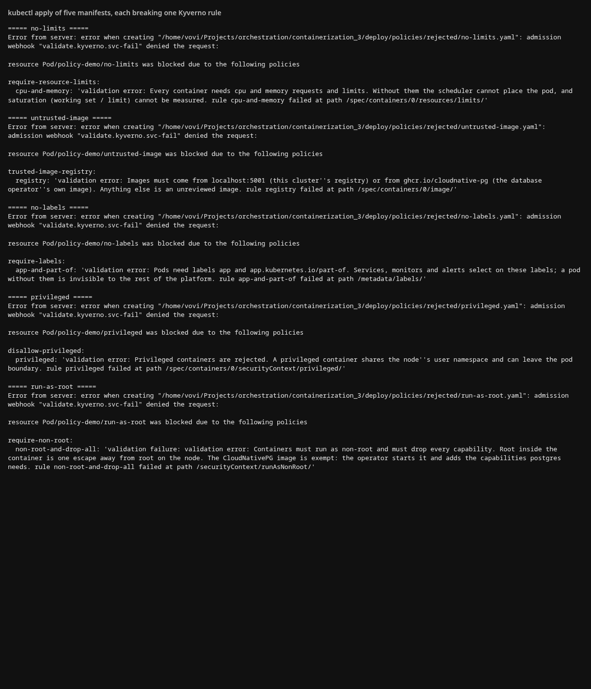

После этого `shop` встаёт чисто: лимиты, образ `localhost:5001`, лейблы, non-root, `drop: [ALL]`, без privileged. С первой попытки не встал. `runAsNonRoot` я повесил только на pod, а правило, которое Kyverno генерирует само, смотрит `securityContext` контейнера. Перенёс поле на контейнер, второй `helm upgrade` прошёл.

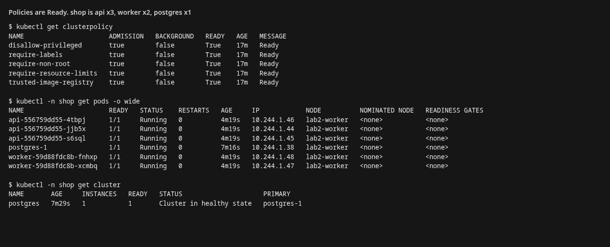

## Часть 2 — чарт и reconciliation

`api` — 3 реплики, `worker` — 2. Пробы readiness и liveness на `GET /health`. Rolling update: `maxUnavailable: 0`, `maxSurge: 1`, чтобы старые поды не снимались, пока новый не Ready. `HEALTH_FAIL=true` заставляет `/health` отвечать 500: readiness нового пода не проходит, rollout стоит.

Удаление пода ничего не удаляет насовсем. Replica-контроллер в controller-manager видит «в spec 3, живых 2» и создаёт замену. Чтобы сервис исчез, надо менять spec Deployment.

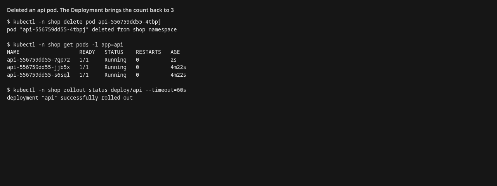

`helm upgrade --set api.replicaCount=4` меняет желаемое число. Фактическое догоняет. Обратный upgrade возвращает 3.

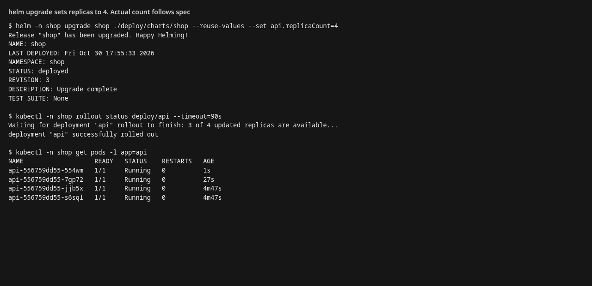

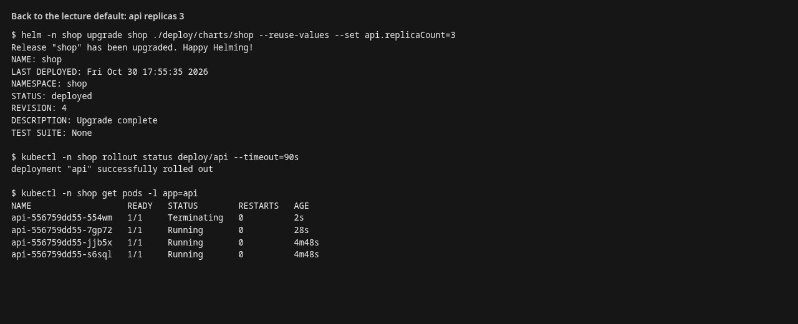

Обновление образа `api` с `0.1.1` на `0.1.2` при `maxUnavailable: 0`. Rollout status показывает смену по одному: сначала 1 из 3, потом 2 из 3, затем старый ReplicaSet уходит. За время раскатки на Service ушло 160 запросов `GET /health`: 159 ответили 200, один оборвался в момент, когда под уже снимали. Ноль готовых подов не было.

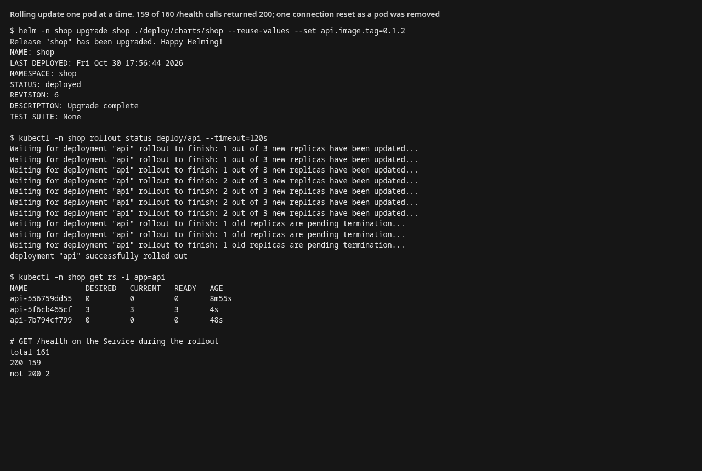

Сломанный релиз: `HEALTH_FAIL=true`. Новый ReplicaSet просит 1 под (`maxSurge: 1`), у него Ready 0. Старый ReplicaSet остаётся 3/3. `rollout status` не дожидается успеха. Все 80 запросов `/health` за это время ответили 200: Service продолжает попадать в старые поды.

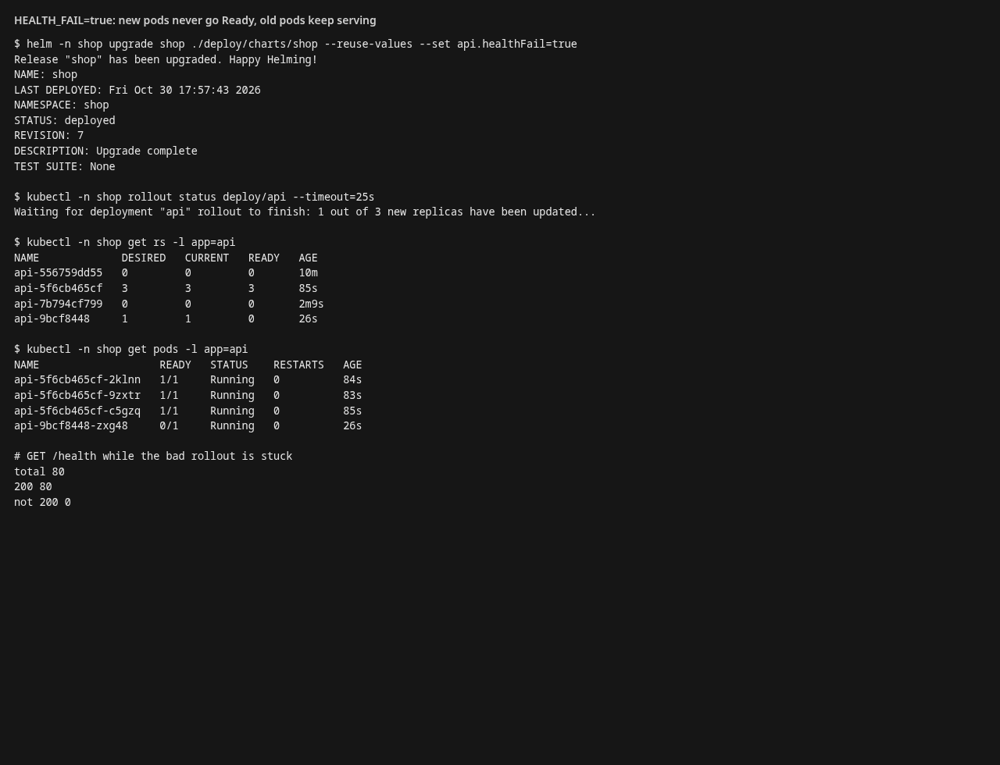

`helm rollback` возвращает предыдущую ревизию. `HEALTH_FAIL=false`, версия `0.1.2`, старый ReplicaSet снова 3/3, `/health` отвечает `ok`.

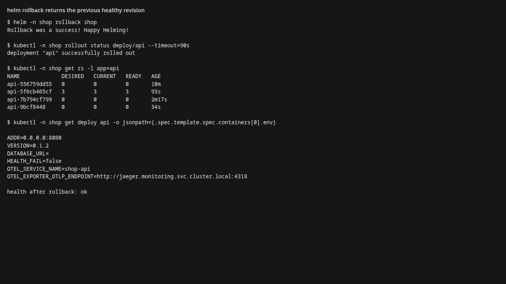

## Часть 3 — postgres через оператор

Оператор — это CRD плюс свой контроллер. controller-manager крутит встроенные типы: именно он вернул под `api`, потому что у Deployment в spec три реплики. CloudNativePG знает, кто primary, кто follower и как поднять данные с диска. У копий базы есть эти роли. В этом чарте `instances: 1`, то есть один primary.

Объект `Cluster` создаётся шаблоном чарта, оператор стоит в кластере один раз. Удаление пода `postgres-1` не меняет spec. Оператор видит instances: 1, пода нет, и создаёт под заново с новым uid, таким образом кластер снова healthy. Убрать базу можно, удалив объект `Cluster`.

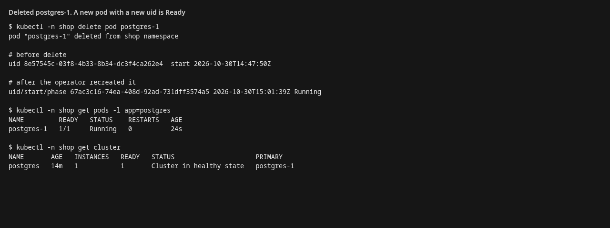

`spec` пишет человек (instances, образ, размер диска, лимиты, лейблы). `status` заполняет оператор: phase, сколько инстансов готово, кто primary.

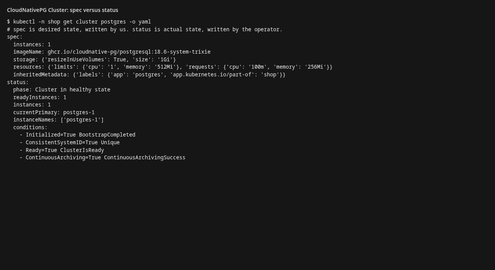

## Часть 4 — control plane

etcd остановлен так, как его запускает kind: манифест статического пода убран из `/etc/kubernetes/manifests` на control-plane. kubelet на этом узле гасит etcd. `kubectl get pods` не доходит до API server (`context deadline exceeded`): менять кластер нельзя, писать в etcd некому. С worker-узла, мимо API server, `GET /health` отвечает `ok`, `GET /orders` отдаёт список. Поды держит kubelet на узле.

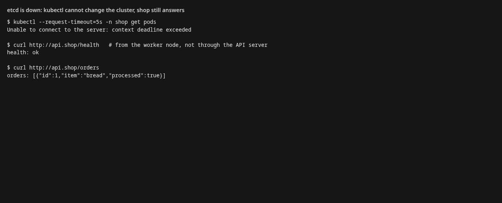

Манифест возвращён на место. Под etcd поднялся, `kubectl` снова перечисляет поды, `/health` по-прежнему `ok`.

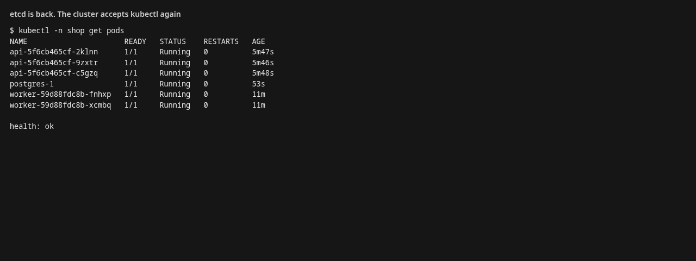

## Часть 5 — мониторинг

Стек второй лабы второй раз не поднимал. В чарте `shop` лежат `ServiceMonitor` (job беру из лейбла `app`, иначе серии `api` и `worker` смешаются) и `PrometheusRule`. Селекторы kube-prometheus-stack открыты, поэтому правила подхватываются без лейблов оператора. Дашборд — ConfigMap с `grafana_dashboard=1`, sidecar Grafana его находит.

Три алерта, все про симптом для пользователя, все с `for: 5m`, как в лекции: дольше пяти минут. Страницы по CPU нет.

1. **ShopApiErrorRateHigh** — доля 5xx среди запросов не на `/health` выше 5%. Клиент уже получает ошибку. Пробы исключены: они почти всегда 200 и разбавляют долю.
2. **ShopApiLatencyP95High** — p95 успешных (2xx) запросов не на `/health` выше 2 с.
3. **ShopOrdersStuck** — `shop_orders_unprocessed > 0` пять минут. API при этом Ready, заказы приняты, worker их не разбирает.

Срабатывание третьего: `worker` смасштабирован в 0, `POST /order` записал заказ `milk`. Гейдж на дашборде поднялся с 0 до 1, через пять минут алерт стал firing. На снимке он на receiver `null`: маршрут из лабораторной 2 пускал на webhook только три имени `Api*`. В values того же стека матчер расширен на `ShopApiErrorRateHigh`, `ShopApiLatencyP95High` и `ShopOrdersStuck`. Worker после снимка возвращён на 2 реплики, заказ `milk` разобран.

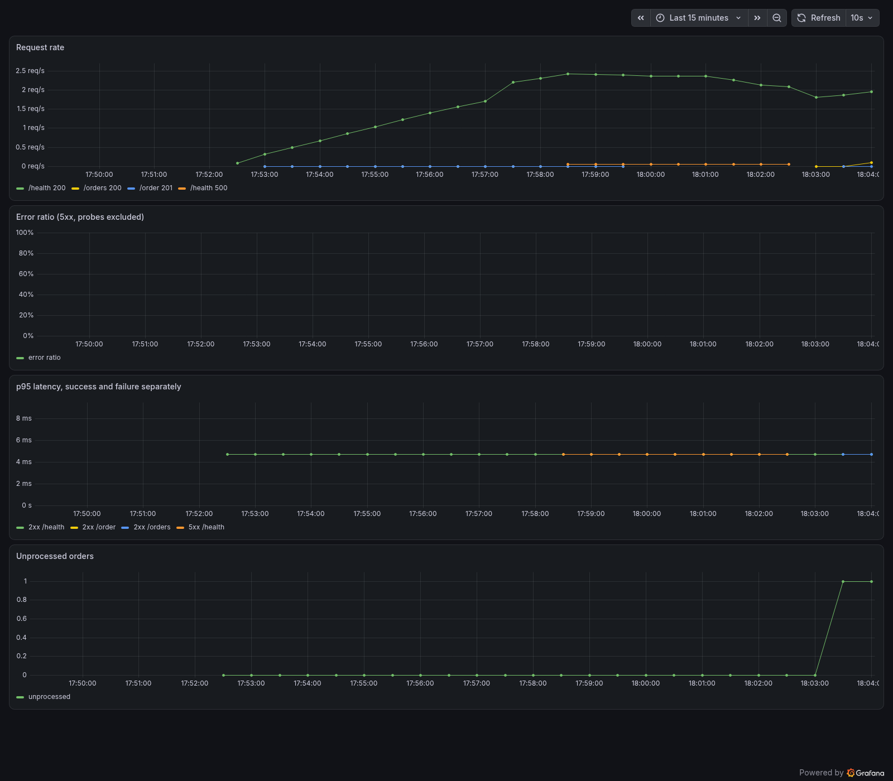

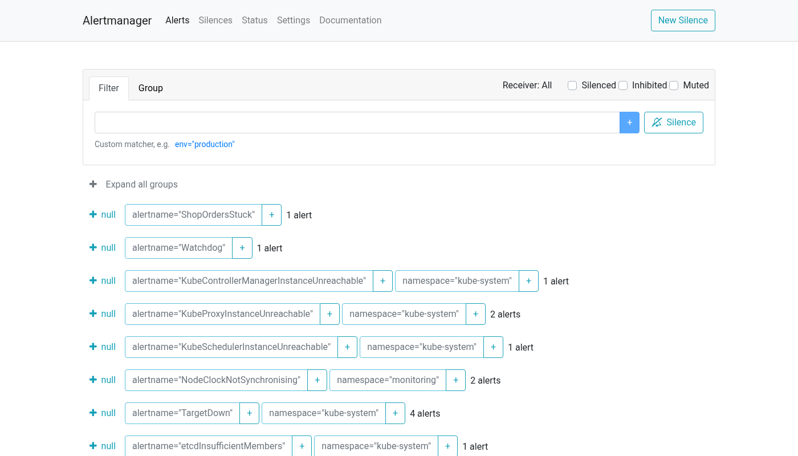

## Состав сдаваемых материалов

- [`api`](api) — `api` и `worker`, общий пакет телеметрии, Dockerfile;
- [`deploy/policies`](deploy/policies) — пять ClusterPolicy и пять отклоняемых манифестов;
- [`deploy/platform/helmfile.yaml`](deploy/platform/helmfile.yaml) — Kyverno и CloudNativePG;
- [`deploy/charts/shop`](deploy/charts/shop) — Deployment, Service, Cluster CloudNativePG, ServiceMonitor, PrometheusRule, дашборд;
- этот отчёт и снимки из [`screenshots`](screenshots).
