# Лабораторная работа № 4 — SLA критического пути под нагрузкой

Снова kind `lab2` и чарт `shop` из третьей лабы, мониторинг не переставлял. Дашборд и правила уже в чарте, kube-prometheus-stack их подхватывает. `batch` — заглушка «ночной аналитики»: крутит CPU, держит память и больше ничего полезного не делает.

## Информация о работе

- Автор: **Бессонов Владимир Юрьевич, K4111c**
- Операционная система: Arch Linux
- Кластер: kind `lab2`, Kubernetes `v1.37.0`, два узла (`lab2-control-plane`, `lab2-worker`)
- krr: Robusta KRR `v1.31.1`, стратегия `simple`

## Часть 1 — как разъезжаются реплики

В `values.yaml` параметр `scheduling.mechanism`. Два значения:

- `podAntiAffinity` — эти поды никогда не на одном узле. Для трёх реплик и двух узлов третья реплика остаётся `Pending` навсегда: пары «разные узлы» для трёх подов не существует.
- `topologySpreadConstraints` — баланс. `maxSkew: 1` и `topologyKey: kubernetes.io/hostname` разрешают раскладку 2 и 1. Все три реплики работают, и они не собраны на одной машине.

Оставил `topologySpreadConstraints`. Узлов два, реплик три, для anti-affinity пары узлов не хватает и третья реплика осталась бы в Pending. Spread с `maxSkew: 1` даёт раскладку 2 и 1.

До spread все поды shop сидели на `lab2-worker`. У control-plane taint `node-role.kubernetes.io/control-plane:NoSchedule`, обычный под туда не ставится. Taint я не снимал. Toleration повесил только на `api`, так что заказ может встать на оба узла, а `batch` на control-plane не попадает и не давит на etcd с apiserver.

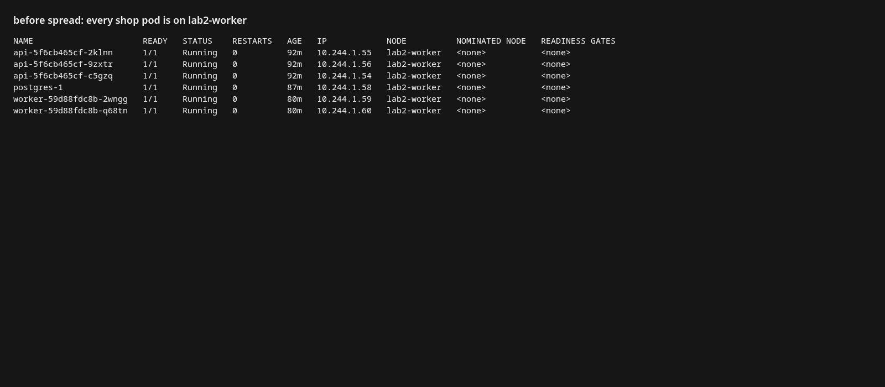

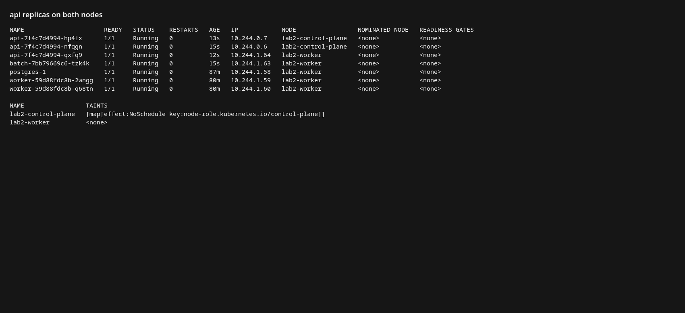

Отказ одного узла больше не уносит все реплики api. На control-plane остаётся одна, на worker — две (skew равен 1). `postgres` и `worker` toleration не имеют и остаются на worker: база одна, отдельный узел под неё на кластере из двух машин отнял бы единственный worker у всего остального. Лекция предлагает dedicated-узел через taint, когда узлов больше.

## Часть 3 — цифры krr

Исходная догадка в чарте лабораторной 3:

| workload | request | limit |
| --- | --- | --- |
| api, worker | 50m / 64Mi | 500m / 256Mi |
| postgres | 100m / 256Mi | 1 / 512Mi |

Перед замером k6 четыре минуты бил в `POST /order` (5 VU, 277968 заказов, p95 6.9 мс, ошибок нет). Затем `krr simple` по namespace `shop`: история 2 часа, шаг 1 минута, CPU — 95-й перцентиль, память — максимум рабочего набора плюс 15%. Порог числа точек снижен до 2, потому что поды api только что переехали и длинной истории у них нет.

Стратегия `simple` оставляет CPU limit пустым и ставит памяти одинаковые request и limit. Полный JSON — `krr/report.json`, короткая выжимка — `krr/recommendations.txt`.

| workload | CPU request | memory |
| --- | --- | --- |
| api | 212m | 100Mi |
| worker | 10m | 100Mi |
| batch | 10m | 100Mi |

10m и 100Mi — нижние пороги самого krr (`cpu_min_value`, `memory_min_value`). Сдвинулся только api: под нагрузкой p95 CPU дошёл до 212m при запросе 50m. Запрос 50m был ниже того, что процесс реально брал, а limit 500m / 256Mi был потолком «с запасом», до которого потребление не доходило. Память api в рабочем наборе была около 15Mi, krr поднял её до своего пола 100Mi.

`postgres` krr не видит: CloudNativePG создаёт поды из CR `Cluster`. Та же формула по контейнеру `postgres` пода `postgres-1`: CPU p95 = 125m, рабочий набор 100077568 байт × 1.15 = 110Mi. Эти числа записаны в `spec.resources` кластера, и оператор копирует их и на postgres, и на sidecar `bootstrap-controller`. Sidecar сидит около 22Mi, в 110Mi он помещается.

В чарт легли эти числа. CPU limit стратегия оставляет пустым, но правило лабораторной 3 требует limit, а Guaranteed (часть 5) требует request = limit. Поэтому CPU limit api и postgres поставлен равным рекомендованному request.

`batch` в эту таблицу не переносился. krr видел его в простое (10m/100Mi). Это как раз тот под, который ниже специально занижен по request и завышен по limit.

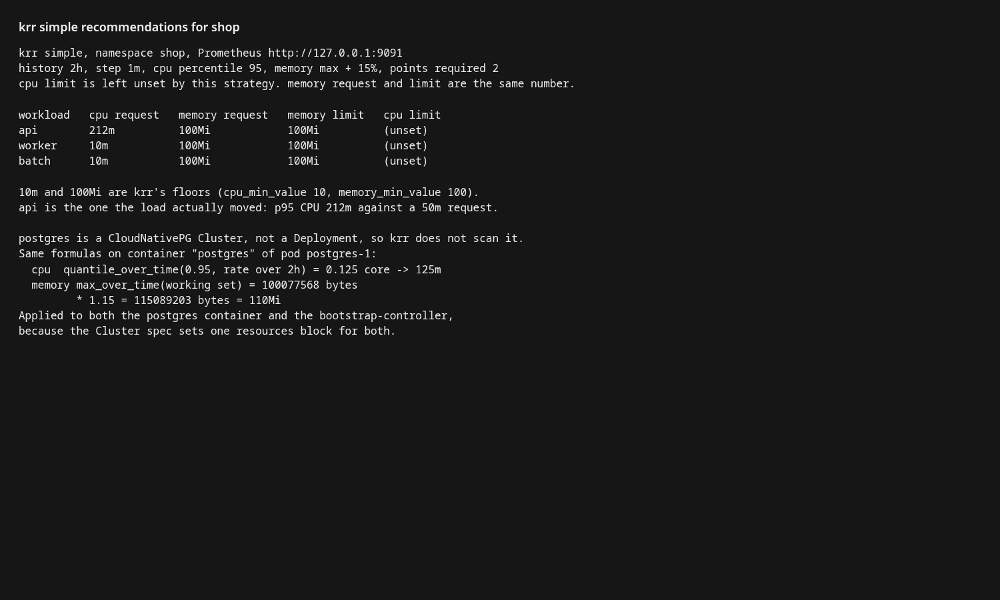

## Часть 5 — приоритет, QoS, PDB

- `api` и `postgres`: `priorityClass` `shop-critical` (значение 1000000), request = limit, QoS **Guaranteed**. PDB `api` с `minAvailable: 2`. PDB `shop-postgres` с `minAvailable: 1`.
- `batch`: `priorityClass` `shop-batch` (значение −100, `preemptionPolicy: Never`), request заметно ниже limit (64Mi против 2Gi, 50m против 1), QoS **Burstable**. Limit при этом есть: правило лабы 3 действует и на него.
- `worker` оставлен на приоритете по умолчанию (0): выше batch, ниже критического пути. krr выровнял его request и limit, поэтому он тоже Guaranteed. Жертвовать им лекция не просит.

Guaranteed снимают последними, когда на узле кончается память. Burstable — раньше. BestEffort (ни request, ни limit) — первыми. Приоритет внутри этого порядка решает, кого вытеснить, и отдельно работает в планировщике: высокий приоритет может выселить низкий, если по запросам место кончилось. `preemptionPolicy: Never` у batch значит, что сам batch никого не выселяет. PDB не участвует в этом выселении: он запрещает добровольный drain. У единственного primary `minAvailable: 1` даёт ноль допустимых disruptions, то же самое делает собственный PDB оператора `postgres-primary`. В событиях пода есть `MultiplePodDisruptionBudgets`: под попал под оба, Kubernetes выбирает один. Для одной реплики это и есть защита «базу добровольно не снимать».

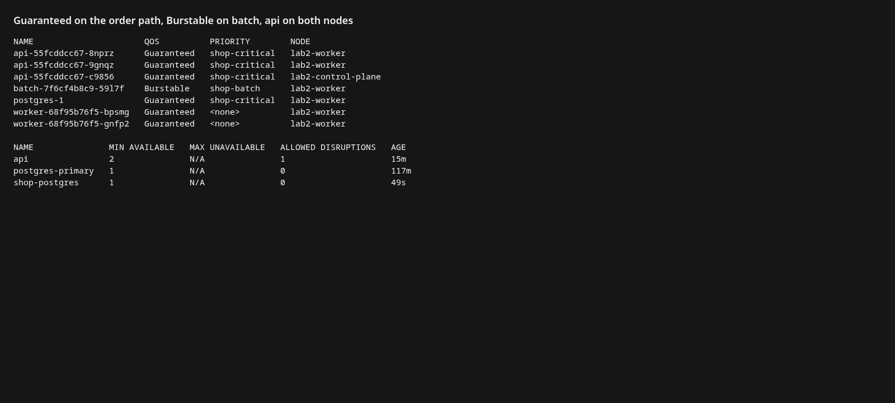

## Часть 6 — Pending и preemption

Планировщик смотрит сумму **requests**. У `batch` request памяти поднят до 28000Mi при limit 30Gi (это всё ещё Burstable: числа не равны) и `replicaCount: 2`. Процесс при этом держал 32Mi. Один под встал на worker, узел по requests оказался занят на 95%. Второй остался `Pending`:

`0/2 nodes are available: 1 Insufficient memory, 1 node(s) had untolerated taint(s). preemption: not eligible due to preemptionPolicy=Never.`

Память на машине была свободна. Не влез резерв. Control-plane отрезан taint'ом, а свой `Never` не даёт batch выселить соседей, чтобы влезть самому.

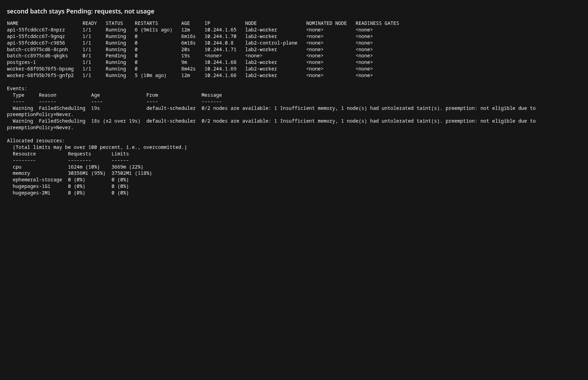

Дальше request/limit памяти у postgres подняты до 2Gi (числа равны, QoS остаётся Guaranteed). Новый под primary на worker не помещался в остаток резерва. Планировщик выселил batch: приоритет `shop-critical` выше −100. Событие `Preempted by pod ecf84e73-cb14-4a17-8bef-94bc67b05975` — это uid пода `postgres-1`. После проверки числа возвращены к рекомендации krr (125m / 110Mi), резерв batch — к 64Mi / 2Gi.

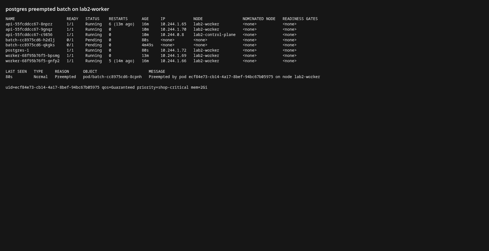

## Часть 7 — давление по памяти и OOMKilled

Это два разных события с похожим симптомом «под умер».

**Свой limit.** `batch` попросили держать 200Mi при limit 64Mi. Ядро убило процесс cgroup'ом контейнера: `OOMKilled`, exit 137, дальше `CrashLoopBackOff`. Лечится своим limit или утечкой.

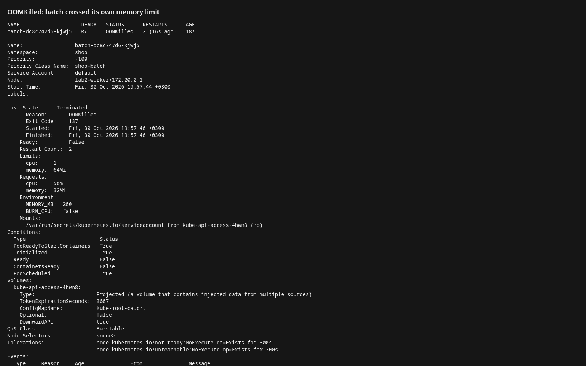

**Eviction узла.** kind по умолчанию в `evictionHard` оставляет только диск и ставит пороги в 0%, то есть дефолтный порог `memory.available` выключен: kubelet по памяти сам никого не снимет, пока не кончится RAM хоста. На время проверки в конфиг kubelet worker'а добавлен `memory.available: 20Gi`, затем 24Gi. `batch` держал около 8Gi при своём limit 12Gi, то есть свой потолок он не пробил. `MemoryPressure` стал `True`, и kubelet снял поды.

Первыми ушли поды Grafana: у них request памяти 0, это BestEffort, и в событии прямо написано `request is 0`. Это порядок из лекции. Следом снят `batch`: `Container batch was using 8220332Ki, request is 64Mi`. `api` и `postgres` в этот момент Guaranteed и остались `Running`. После проверки порог из конфига kubelet убран, Grafana поднялась обратно (Deployment пересоздал под), `batch` возвращён к 32Mi при limit 2Gi.

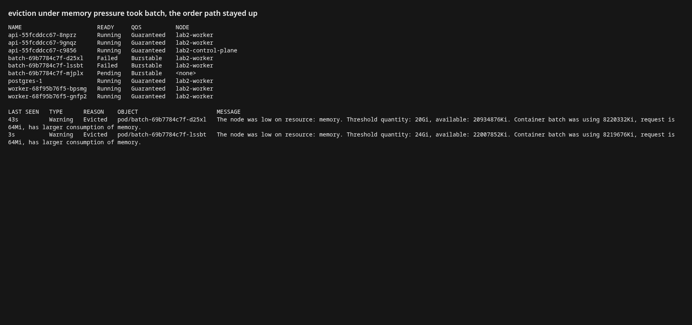

## Часть 8 — SLA

Свой SLA: **95% успешных** `POST /order` **быстрее 300 мс, доля 5xx ниже 1%**, в том числе когда фоновая нагрузка деградирует.

Первый прогон, до дефицита: 277968 заказов за 4 минуты, p95 = 6.9 мс, 5xx = 0. На графике линия p95 лежит у нуля, порог 300 мс — сверху. Запросы шли через port-forward на один endpoint Service, то есть на одну реплику api; этого достаточно, чтобы увидеть путь api → postgres.

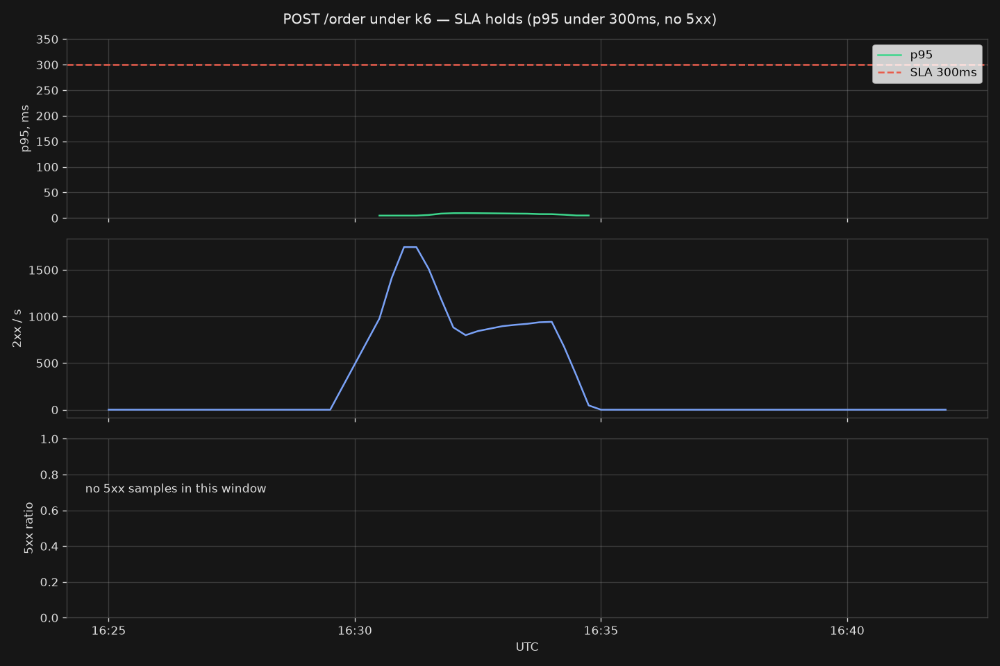

Второй прогон шёл, пока worker был в `MemoryPressure` и kubelet снимал `batch`: 49325 заказов за 45 секунд, p95 = 19 мс, ошибок нет. Деградировал batch и BestEffort-соседи без requests. Приём заказа шёл дальше.

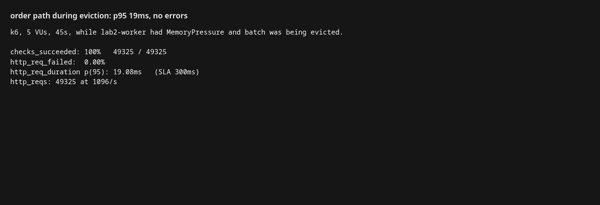

## Часть 9 — три алерта

Правила в чарте, `for: 5m`, окно `rate` 5 минут. Страница — симптом для пользователя.

1. **ShopOrderPathSlow** — p95 успешных `POST /order` выше 300 мс. Это сам SLA критического пути. Ряд режется по `code=~"2.."`.
2. **ShopApiErrorRateHigh** — доля 5xx среди запросов не-проб выше 5%. Заказ перестал приниматься. `route!="/health"`, чтобы пробы не разбавляли знаменатель.
3. **ShopOrdersStuck** — gauge `shop_orders_unprocessed` больше нуля. Заказ принят (критический путь жив), но фон его не разбирает: worker или postgres.

Сработал третий. k6 принял сотни тысяч заказов, worker забирает по одной строке в секунду, очередь не пустела пять минут. Alertmanager отдал его на receiver `sink`.

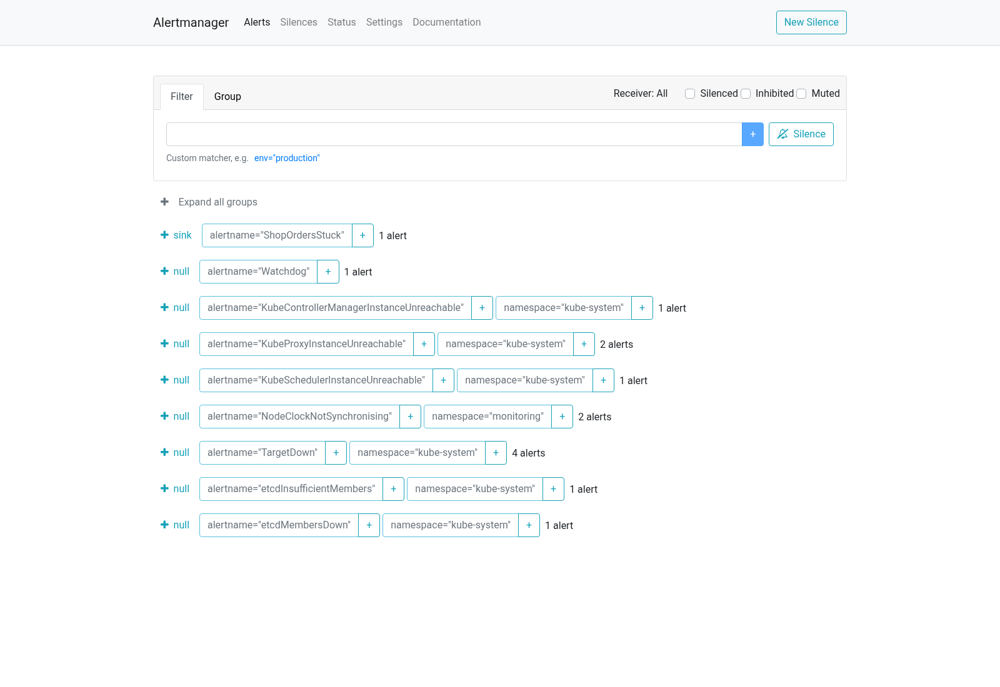

`ShopOrderPathSlow` за эти прогоны не зажигался: p95 был 7 мс и 19 мс. Молчание этого алерта и есть выполнение SLA. Очередь после проверки очищена (`TRUNCATE`), чтобы алерт не висел на уже разобранном эксперименте.

Дашборд `shop golden signals` в том же ConfigMap: к панелям третьей лабораторной добавил p95 и долю ошибок именно `POST /order`, порог 300 мс. Grafana в браузере у меня так и не отдала статику («failed to load its application files»), поэтому график SLA снял теми же PromQL, которыми нарисованы панели.
