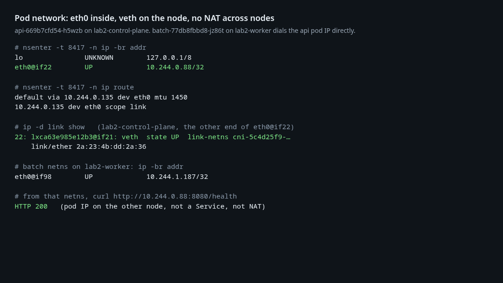
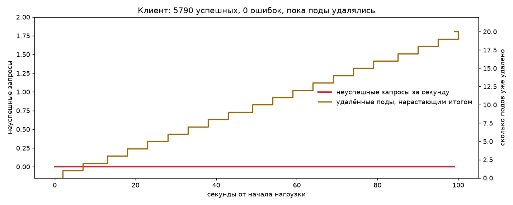
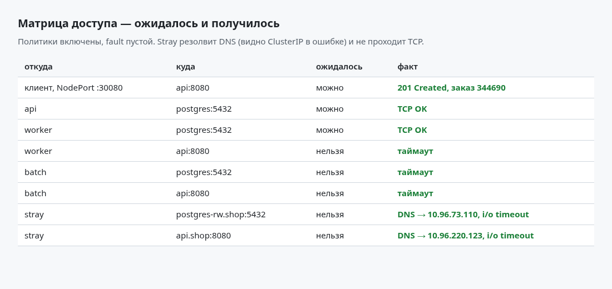
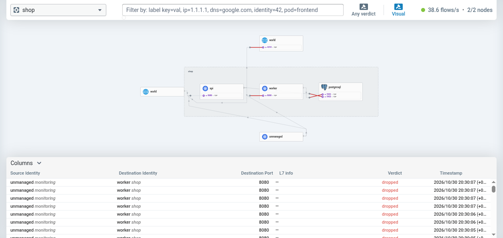
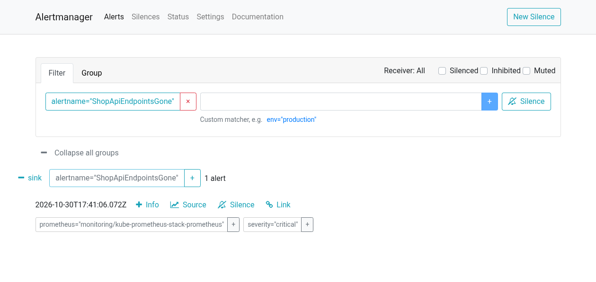
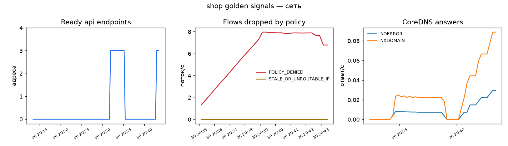

# Лабораторная работа № 5 — сеть с нулевым доверием и доказательством

Тот же kind `lab2` и тот же чарт. Мониторинг опять не поднимал: дашборд и правила уже в чарте. CNI сменил. Поставил Cilium рядом с живым kube-proxy и kindnet после этого убрал.

## Информация о работе

- Автор: **Бессонов Владимир Юрьевич, K4111c**
- Операционная система: Arch Linux
- Кластер: kind `lab2`, Kubernetes `v1.37.0`, два узла (`lab2-control-plane` `172.20.0.3`, `lab2-worker` `172.20.0.2`)
- CNI: Cilium `1.20.4`, туннель VXLAN, IPAM `kubernetes`. kube-proxy не заменялся

## Часть 0 — почему Cilium

Политику исполняет CNI. kindnet манифест принимает и молча ничего не делает: `NetworkPolicy` лежит в etcd, пакеты ходят как ходили. Calico правила исполняет, но карты трафика у него нет, а в конце лабораторной обрыв надо найти именно по карте. Hubble для этого и нужен, поэтому взял Cilium.

`kubeProxyReplacement` оставил выключенным. kube-proxy у меня в режиме `iptables` (ConfigMap `kube-system/kube-proxy`). Разница с IPVS видна на тысячах Service: iptables идёт по списку правил, IPVS ищет адрес в хеш-таблице. Сервисов тут мало, список короткий, iptables справляется. Менять его не стал — иначе из отчёта пропало бы, в каком режиме он вообще работает.

Cilium забрал конфиг CNI: на узле лежит `/etc/cni/net.d/05-cilium.conflist`, старый kindnet переименован в `10-kindnet.conflist.cilium_bak`. DaemonSet kindnet после этого удалён. Поды, созданные kindnet, своего veth не отдают, пока их не пересоздать. shop пересоздан, и новые поды уже эндпоинты Cilium.

## Часть 1 — как под получает сеть

У пода нет своего ethernet-порта. CNI создаёт пару veth: один конец кладётся в network namespace пода и называется `eth0`, второй остаётся на узле. Cilium называет узельный конец `lxc…`, это всё тот же veth (`link/ether`, `link-netns`). Адрес выдаёт IPAM. Здесь режим `kubernetes`, поэтому под берёт адрес из PodCIDR узла: control-plane `10.244.0.0/24`, worker `10.244.1.0/24`. Адрес временный: под умер — адрес вернулся в пул, новый под получает другой.

Между узлами пакет не выходит в сеть Docker как есть. Cilium заворачивает его в VXLAN (`cilium_vxlan`). NAT при этом нет: с одного пода на другой уходит исходный IP пода.

`api-669b7cfd54-h5wzb` на control-plane:

```
eth0@if22    UP    10.244.0.88/32
default via 10.244.0.135 dev eth0 mtu 1450
```

Второй конец пары на узле: `22: lxca63e985e12b3@if21`, тип veth. С worker, из netns `batch` (`10.244.1.187`), `curl http://10.244.0.88:8080/health` вернул 200. Это IP пода на другом узле.



Образы shop — scratch, оболочки внутри нет. «Изнутри» снял через `nsenter -t <pid sandbox> -n` с узла kind: сеть пода, утилиты узла.

## Часть 2 — Service переживает смерть подов

`api` опубликован как NodePort `30080`. С хоста это `http://172.20.0.2:30080` и `http://172.20.0.3:30080` (оба отвечали 200). `127.0.0.1:30080` не слушает: kind создан без `extraPortMappings`, NodePort торчит на IP узла, а узел — контейнер Docker в сети `kind`.

Три типа Service:

- **ClusterIP** — виртуальный адрес только внутри кластера. Его и резолвит DNS.
- **NodePort** — тот же ClusterIP плюс один порт на каждом узле. kube-proxy на узле забирает соединение и отдаёт его живому поду. Внешний клиент не знает pod IP.
- **LoadBalancer** — NodePort плюс внешний адрес, который должен выдать облачный контроллер. У kind облака нет, адрес остался бы `<pending>`.
- **Headless** (`clusterIP: None`) — DNS отдаёт IP подов, балансирует сам клиент. Заказ ходит на один адрес, поэтому здесь стоит NodePort.

Нагрузка ходила по DNS-имени `api.shop.svc.cluster.local`. Клиент — под `shop-load` (`localhost:5001/shop-load:0.1.1`): раз в секунду пачка `POST /order`, между запросами 15 мс. Скрипт `scripts/chaos.sh` в это же время удалял случайный Running-под `api` или `worker` каждые 5 секунд. Политики на этот прогон были выключены (`network.enabled=false`), иначе обрыв политики смешался бы с проверкой Service.

За ~100 секунд: **5790 успешных, 0 ошибок**, 21 удаление, в выборке IP побывало 24 разных имени подов. Под умирает, новый получает другой адрес из пула, клиент этого не видит.



Почему запрос у меня не падал вместе с подом. Тут четыре разных механизма, и путать их легко:

1. **Service** держит стабильный ClusterIP. Клиент подключается к нему.
2. **EndpointSlice** — список готовых pod IP. Как только у пода появляется `deletionTimestamp`, его адрес уходит из ready. kube-proxy перестаёт слать туда новые соединения.
3. **kube-proxy (iptables)** записывает правила, по которым ядро само переписывает адрес назначения на один из ready IP и чередует их.
4. **CoreDNS** резолвит `api.shop.svc.cluster.local` в ClusterIP. Имя не меняется, когда меняются поды.

Один запрос всё же может попасть в под, который уже убивают: соединение было открыто до того, как адрес исчез из EndpointSlice. Клиент повторяет такой сбой до четырёх раз. Повтор — новое соединение, и iptables отправляет его на под, который ещё ready. На прогоне с одним повтором из 5793 запросов один не ушёл (оба попали в умирающий под). С четырьмя повторами ошибок нет. Это и есть «клиент не заметил»: имя то же, ClusterIP тот же, живые поды забирают следующий пакет.

## Часть 3 — матрица, до того как что-то закрывать

Пока на под не выбрана ни одна политика, он открыт. Как только выбрана хоть одна — всё, что не разрешено, уже запрещено. Поэтому сначала default-deny на весь namespace, и только потом точечные разрешения по лейблам и портам.

| кто | куда | решение |
| --- | --- | --- |
| клиент снаружи (NodePort) и любой, кому открыт вход | `api:8080` | можно. У ingress нет `from`, порт сервиса |
| `api` | `postgres:5432` | можно |
| `worker` | `postgres:5432` | можно |
| `batch` | postgres, api | нельзя. Ему хватает DNS |
| stray (лейбл не `api` и не `worker`) | postgres | нельзя |
| всё остальное | всё остальное | нельзя |

Отдельно, иначе «нет DNS» не отличить от «postgres закрыт»:

- любой под namespace → CoreDNS (`kube-system`, `k8s-app=kube-dns`, UDP/TCP 53);
- `api` и `worker` → Jaeger OTLP `monitoring:4318`;
- `worker:8080` ← Prometheus из `monitoring` (у `api` вход и так открыт на 8080);
- `postgres` ← оператор CloudNativePG (`cnpg-system`) на 5432, 8000, 9187;
- `postgres` → API-сервер. В политике два ipBlock: `10.96.0.1/32:443` (ClusterIP kubernetes) и `172.20.0.3/32:6443` (узел control-plane). Cilium всё равно классифицирует этот трафик как сущность `kube-apiserver`, и ipBlock его не выбирает — Hubble показывает SYN dropped. Рядом с NetworkPolicy в чарте лежит `CiliumNetworkPolicy` с `toEntities: kube-apiserver`. Это то правило, которое совпадает.

## Часть 4 и 5 — политики и зелёная матрица

Шаблоны в `deploy/charts/shop/templates/networkpolicy.yaml`, порты и адреса — из `values.yaml`. `network.fault` пустой.

Проверка после включения. Снаружи заказ проходит. Из netns `api` и `worker` TCP до ClusterIP postgres открывается. Из `batch` и `worker` до api — таймаут (у worker в egress нет api, вход api при этом открыт: режет исходящий). Stray-под с образом `localhost:5001/shop-probe:0.1.0`, лейблы `app=stray` и `app.kubernetes.io/part-of=shop` (не `api`, в Service он не попадает). Оба адреса он резолвит — DNS разрешён — и на TCP получает `i/o timeout`.

| откуда | куда | ожидалось | факт |
| --- | --- | --- | --- |
| клиент, NodePort | api:8080 | можно | 201, заказ 344690 |
| api | postgres:5432 | можно | TCP OK |
| worker | postgres:5432 | можно | TCP OK |
| worker | api:8080 | нельзя | таймаут |
| batch | postgres:5432 | нельзя | таймаут |
| batch | api:8080 | нельзя | таймаут |
| stray | postgres-rw.shop:5432 | нельзя | DNS → 10.96.73.110, timeout |
| stray | api.shop:8080 | нельзя | DNS → 10.96.220.123, timeout |



## Часть 6 — скрытый обрыв

`scripts/fault.sh` выбирает один из `no-dns`, `wrong-port`, `wrong-label`, `deny-postgres`, пишет его в `scripts/.fault` и делает `helm upgrade --set network.fault=…`. Файл не открывался, пока карта не показала причину.

Симптом: `POST /order` на NodePort, который только что отвечал 201, завис до таймаута клиента. Заказ не создаётся.

`hubble observe --namespace shop --verdict DROPPED`:

- `shop/api-…` и `shop/worker-…` → `shop/postgres-1:5432`, `EGRESS DENIED`, `Policy denied`. Это путь заказа.
- Рядом были дропы `postgres → 172.20.0.3:6443` и `unmanaged monitoring → worker:8080`. Первое — API-сервер, о нём ниже. Второе — Prometheus, поднятый ещё kindnet: у пода не было identity Cilium, селектор namespace `monitoring` его не видел. Под пересоздан, после этого `up{job="worker"}` снова 1. Заказ обрывался дальше, на postgres: NodePort на api в тот момент ещё принимал соединение.

Дальше развилка, тоже по Hubble. С пода api набран IP пода postgres и на 5432, и на 5433. Оба таймаут. `wrong-port` открыл бы 5433 (ядро postgres ответило бы RST, порт закрыт). `wrong-label` сломал бы только источник `api`, а worker тоже дропался. `no-dns` не дропает соединение по уже известному IP. Значит разрешение egress на postgres снято целиком. Это `deny-postgres`.

Карта Hubble UI (namespace shop): красные стрелки от `api` и от `worker` в `postgresql:5432`.



После этого `scripts/.fault` содержал `deny-postgres`. `helm upgrade --set network.fault=""` вернул разрешения. Следующий заказ — 201, матрица снова зелёная.

## Часть 7 — три алерта

Метрики Hubble снимает ServiceMonitor `hubble` в чарте: Service `kube-system/hubble-metrics`, порт `hubble-metrics` (9965). Имена сверены с живым Prometheus. `for: 5m`, `rate` по пяти минутам. На CPU ничего не пейджит. Один stray-проб не держит порог.

1. **ShopApiEndpointsGone** — `(sum(kube_endpointslice_endpoints{namespace="shop",endpointslice=~"api-.*",ready="true"}) or vector(0)) == 0`. Симптом части 2, если он затянулся: имя сервиса живо, готовых адресов нет, kube-proxy некуда слать соединение. `or vector(0)` нужен, потому что при пустом EndpointSlice ряд пропадает, и голый `sum == 0` не срабатывает. Для проверки селектор Service `api` на пять минут переключён на лейбл, которого нет ни у одного пода. Поды при этом работали, PDB не трогался.
2. **ShopNetworkPolicyDenies** — `sum(rate(hubble_drop_total{reason="POLICY_DENIED",protocol="TCP"}[5m])) > 1`. Страница, когда политику ломают и дроп держится. Порог 1 поток/с: пара SYN от stray за пять минут его не берёт, а оборванный egress на postgres (и SYN postgres к API-серверу, пока ipBlock не совпадал) берёт. Считается TCP и `reason="POLICY_DENIED"`.
3. **ShopDnsUnhealthy** — CoreDNS отвечает `SERVFAIL`/`REFUSED` чаще 1/с, либо `up{job="coredns"}` упал в 0. Это болезнь самого DNS. Если политику DNS просто убрали, пакет до CoreDNS не доходит, и этот алерт молчит: тот обрыв виден как дроп Hubble и попадает во второй алерт.

Маршрут Alertmanager в лабораторной 2 дополнен этими именами и `ShopOrderPathSlow`, иначе страница осталась бы на receiver `null`.

Оба новых симптома дошли до receiver `sink` (Watchdog и etcd по-прежнему на `null`). **ShopApiEndpointsGone** — пока у Service не было ready-адресов: селектор на пять минут указывал на лейбл, которого нет ни у одного пода. **ShopNetworkPolicyDenies** — в ту же минуту: SYN `postgres` к `172.20.0.3:6443` дропались быстрее 1/с, ipBlock их не выбирал. После `CiliumNetworkPolicy` Hubble пишет на этот поток `EGRESS ALLOWED` и `FORWARDED`. Селектор Service возвращён на `app=api`, следующий заказ — 201, EndpointSlice снова с тремя адресами.



Дашборд `shop golden signals` (ConfigMap чарта, сайдкар Grafana) получил три панели: готовые эндпоинты api, дропы политики, ответы CoreDNS по rcode. Ниже те же три выражения из Prometheus за полчаса. Провал ready-адресов — проверка первого алерта. Рост `POLICY_DENIED` — SYN к API-серверу, пока сущность не была разрешена; к концу интервала счётчик уже пошёл вниз.



## Что лежит в репозитории

- `deploy/cilium/values.yaml` — установка Cilium, с которой поднят релиз.
- `deploy/charts/shop` — NodePort для api, NetworkPolicy, CiliumNetworkPolicy на API-сервер, ServiceMonitor Hubble, PrometheusRule, дашборд.
- `scripts/chaos.sh`, `scripts/fault.sh`.
- `load/`, `probe/` — клиент нагрузки и проб матрицы. Образы `localhost:5001/shop-load:0.1.1` и `localhost:5001/shop-probe:0.1.0`.
