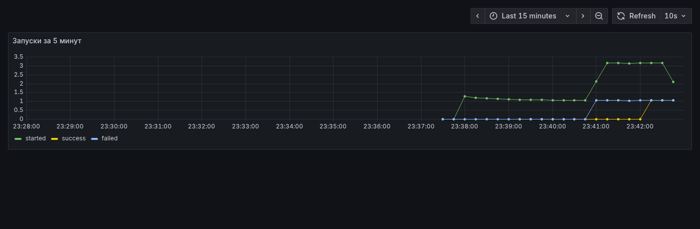
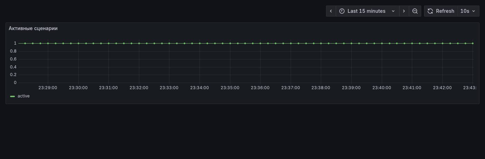
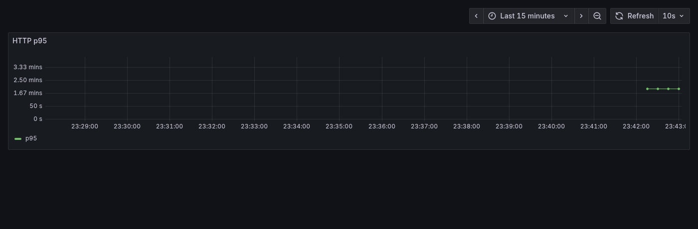

# Лабораторная работа № 7 — ворота релиза

Kind с прошлых лабораторных здесь не поднимал. Сценарий `release-gate` живёт в своём `docker compose` и слушает только `127.0.0.1`.

## Информация о работе

- Автор: **Бессонов Владимир Юрьевич, K4111c**
- Операционная система: Arch Linux
- n8n `1.114.0`, модель `qwen2.5:3b` в Ollama, Prometheus `v3.5.0`, Grafana `12.1.0`

## Кто и зачем

«Северная Полка» возит продукты по Петербургу, человек сорок. Платформенная команда выпускает `order-api` два раза в неделю. Перед выкладкой капитан релиза Лена Орлова минут двадцать сверяет журнал изменений, открытые инциденты и CI. По пятницам сверку пропускают, и в прод уезжает релиз, который ещё рано было выпускать.

Ворота делают эту сверку сами. Лена шлёт один POST с версией и именем сервиса. Сценарий проверяет тело, спрашивает CI, агент по навыку читает репозиторий и доску дежурства и пишет записку: GO или NO-GO. Записка остаётся файлом, тот же текст возвращает вебхук.

На данных, с которыми я гонял: пятничное окно открыто, CI зелёный (`142 passed`, коммит `b7e1c0a`), открыт `INC-184` у `picker-app` уровня sev3, в журнале `order-api` написано «схема не меняется». Записка для `2026.44` вышла GO, внутри строка из журнала и номер `INC-184`.

## Как идёт сценарий

1. Дверь `gate` принимает `POST` с `{ "version", "service" }` и отдаёт его вебхуку n8n.
2. Узел Validate — обычный код. Нет версии или сервиса, сценарий падает, записки нет.
3. Узел CI status — обычный HTTP `GET` к `ci-mock`.
4. Агент с навыком [`skills/release-gate.md`](skills/release-gate.md) вызывает инструменты двух MCP-серверов и пишет `/data/out/release-<version>.md`.
5. Узел Read verdict читает этот файл. Файла нет — сценарий падает.
6. Узел Respond отдаёт путь и текст записки.

Порядок и правила лежат в навыке. GO, пока заморозка выключена, у этого сервиса нет открытых sev1/sev2, CI зелёный и в журнале нет «migration» или «миграц». В журнале `2026.44` стоит «схема не меняется», навык на этом выпуск пропускает.

## Инструменты

Два MCP-сервера по SSE, пять инструментов.

| Инструмент | Сервер | Что делает | Вход |
| --- | --- | --- | --- |
| `list_release_files` | release-files | имена файлов репозитория | `repo`, единственный репозиторий `release` |
| `read_release_file` | release-files | текст одного файла | `name`, только имя, путь отвергается |
| `write_verdict` | release-files | записка в `/data/out` | `version`, `markdown` |
| `list_open_incidents` | release-incidents | открытые инциденты | `service` |
| `release_freeze` | release-incidents | заморозка с доски | `board`, единственная доска `oncall` |

`write_verdict` пишет файл, когда в тексте есть фраза из журнала, номер каждого открытого инцидента и первая строка `GO` или `NO-GO`. При выключенной заморозке и без sev1/sev2 первая строка `NO-GO` отвергается: у модели есть шанс её поправить.

Модель маленькая, `qwen2.5:3b`, крутится на CPU. Она часто ломает кавычки в вызове (`"repo: "release"`), и Ollama выбрасывает весь ответ. Ещё она зовёт несколько инструментов за один ход, а клиент n8n 1.114 склеивает такие куски потока в один сломанный вызов. Перед Ollama стоит `ollama-shim`: чинит кавычку, оставляет один вызов за ход и, пока не сделаны пять чтений из навыка, подставляет следующий шаг. Текст записки после ответов инструментов пишет уже модель. Записка цитирует внутренние инциденты, модель из-за этого локальная. Плачу за это временем CPU, отдельной видеокарты нет.

## Как запустить

Из этого каталога:

```bash
docker compose up -d --build
docker compose exec ollama ollama pull qwen2.5:3b
python3 workflow/import_workflow.py
```

Скрипт печатает id сценария и адрес вебхука вида `http://127.0.0.1:5678/webhook/<id>/webhook/release-gate`.

Капитан ходит в дверь `gate` на `127.0.0.1:5680`. Время ожидания записки меряется на двери: гистограмма HTTP у n8n считает REST-редактор.

```bash
curl -X POST http://127.0.0.1:5680/ \
  -H 'content-type: application/json' \
  -d '{"version":"2026.44","service":"order-api"}'
```

Ответ — JSON с путём и текстом. Файл появляется в `data/out/release-2026.44.md`. Прогон на CPU занял около минуты-полутора.

Редактор n8n: http://127.0.0.1:5678, локальный владелец `lena@severnaya.example` / `ReleaseGate-lab8`. Grafana без пароля: http://127.0.0.1:3008. Prometheus: http://127.0.0.1:9098.

Порты прошлых работ свободны: Grafana `3008`, Prometheus `9098`, n8n `5678`, дверь `5680`. Ollama остаётся внутри compose.

## Наблюдение

n8n отдаёт `/metrics`. Счётчики прогонов включаются `N8N_METRICS_INCLUDE_MESSAGE_EVENT_BUS_METRICS`, длительность HTTP — `N8N_METRICS_INCLUDE_API_ENDPOINTS`. Дашборд `release gate` в Grafana. Три правила в [`monitoring/rules.yml`](monitoring/rules.yml), все с `for: 5m`, по симптому. Страницы по CPU нет.

- **ReleaseGateFailing** — `sum(rate(n8n_workflow_failed_total[5m])) > 0`. Капитан попросил записку и не получил её. Один кривой JSON за пять минут до страницы не дотягивает.
- **ReleaseGateSlow** — p95 времени на двери выше 30 секунд в окне `[2m]`, и так пять минут. Записка приезжает уже после окна, в которое её ждали. Окно короче `for`, поэтому один медленный прогон на CPU виден на графике и страницу не поднимает.
- **ReleaseGateNotListening** — `n8n_active_workflow_count == 0`. Сценарий выключен, вебхуку некуда идти, кандидат пропадает молча.

## Записка

`data/out/release-2026.44.md`:

```
GO 2026.44
changelog: order-api 2026.44: повтор запроса при обрыве postgres, схема не меняется.
CI: green, 142 passed, commit b7e1c0a
incidents: INC-184 (sev3 other service picker-app: сборка заказа на складе дольше обычного)
```

## Графики

Окно — последние 15 минут. На верхнем графике есть и успешный прогон, и ошибка на пустом теле.







Сам вызов через дверь занял 60 секунд. На графике точка около двух минут: следующая корзина гистограммы после 60 секунд — 120, квантиль встаёт между ними.
